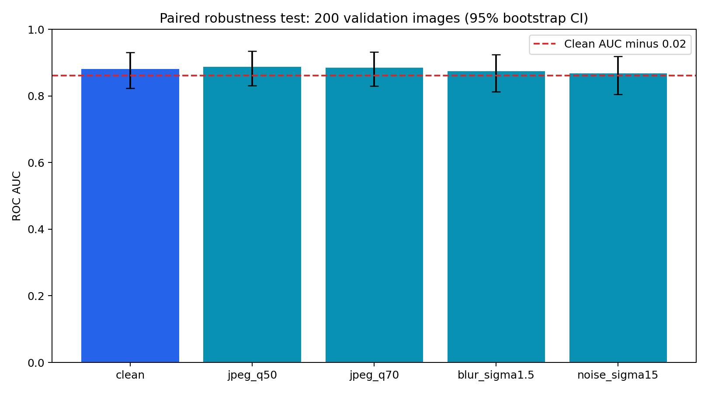
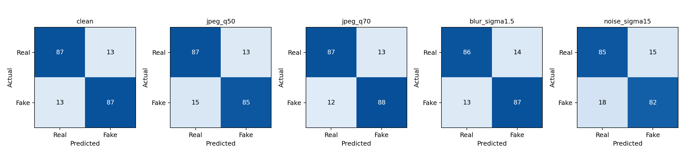
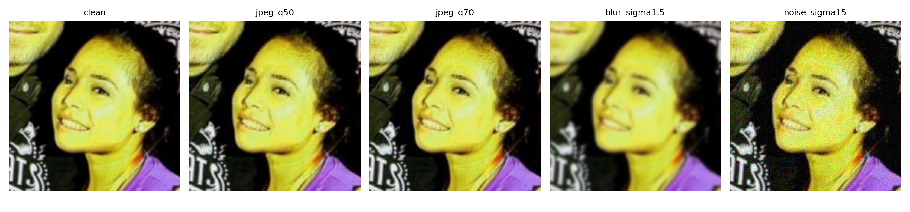

# Deepfake detector robustness report

## Findings

Clean ensemble AUC: **0.8813**. Largest observed degradation: **noise_sigma15**, with AUC **0.8684** and absolute drop **0.0129**.
4 of 4 corruption conditions meet the observed absolute AUC-drop target of less than 0.02.

| Condition | AUC (95% CI) | AUC drop | Accuracy | Precision | Recall | F1 | TN / FP / FN / TP | <0.02 drop? |
|---|---|---|---|---|---|---|---|---|
| clean | 0.8813 (0.8238–0.9306) | 0.0000 | 0.870 | 0.870 | 0.870 | 0.870 | 87 / 13 / 13 / 87 | Yes |
| jpeg_q50 | 0.8874 (0.8314–0.9343) | -0.0061 | 0.860 | 0.867 | 0.850 | 0.859 | 87 / 13 / 15 / 85 | Yes |
| jpeg_q70 | 0.8854 (0.8299–0.9327) | -0.0041 | 0.875 | 0.871 | 0.880 | 0.876 | 87 / 13 / 12 / 88 | Yes |
| blur_sigma1.5 | 0.8740 (0.8133–0.9236) | 0.0073 | 0.865 | 0.861 | 0.870 | 0.866 | 86 / 14 / 13 / 87 | Yes |
| noise_sigma15 | 0.8684 (0.8056–0.9189) | 0.0129 | 0.835 | 0.845 | 0.820 | 0.832 | 85 / 15 / 18 / 82 | Yes |

## Method

200 images (100 real, 100 fake), sampled without replacement from the existing 1,400-image validation split; seed 42. All validation IDs were checked against archive metadata and checked for no ID overlap with the 5,600-image training split. The same images are paired across all conditions. No models were trained and no thresholds or ensemble weights were tuned on these results.

Four-model probability ensemble: EfficientNetV2-S 0.35, ConvNeXt-Tiny 0.30, Swin-Tiny 0.20, DenseNet-121 0.15. Strict checkpoint loading; evaluation mode; FP32; original and horizontal-flip probability averaging; RGB 224x224; ImageNet normalization. Classification threshold 0.5; positive class is fake. Environment and SHA-256 weight hashes are in run_manifest.json.

Each corruption is independently applied to the decoded original: JPEG quality 50/70 with 4:2:0 subsampling; OpenCV Gaussian blur sigma=1.5 with automatic kernel and reflect-101 borders; independent Gaussian pixel noise sigma=15 on the 0–255 scale, clipped and cast to uint8. Noise is deterministic per image. Corruptions are not stacked.

95% percentile intervals use 2,000 stratified bootstrap resamples, paired between clean and degraded images. statistics.csv includes confidence intervals for the AUC drops and relative percentage drops. The target is interpreted as an **absolute drop below 0.02**, not a relative 2% decrease.

## Interpretation and limitations

These are measured validation-sample results, not hidden-test guarantees. A 200-image sample has sampling uncertainty; meeting the observed target does not establish that the true drop is below 0.02. Models were selected using this validation split, so these are not independent final-test estimates. ID separation does not establish identity/source separation. Noise uses one fixed realization per image. No T4 speed or VRAM score is claimed from this CPU run. The handover's projected ensemble AUC and robustness claims were not treated as measured results.

## Files and resuming

- statistics.csv: full metrics and uncertainty estimates.
- predictions_*.csv: all model and ensemble per-image probabilities.
- sample_manifest.csv: exact selected IDs and ground truth.
- auc_comparison.png: AUC comparison with confidence intervals.
- example_*.png: one image under each condition.
- progress.jsonl and checkpoint.json: append-only progress history and latest checkpoint.
- run_manifest.json: reproducibility settings and hashes.

Resume or regenerate the report by running `python SMPS/robustness_test.py` from the workspace root. Completed prediction batches are reused only when the run signature matches.

## Runtime adjustment

DenseNet resumed after unusually slow CPU execution with batch size 2 and two threads, with images prepared on demand, contiguous NCHW layout, MKLDNN enabled, and denormal flushing enabled. Diagnostic runs also tried MKLDNN disabled and one thread; earlier completed batches were retained. The other models used batch size 8 and four threads. All inference used CPU FP32 with identical preprocessing and TTA; batch/backend changes can introduce small floating-point differences. low_memory_resume.json and progress.jsonl record these adjustments. Resume DenseNet and regenerate the report using `python SMPS/robustness_low_memory.py`, then run the model summary script.

## Final verification

Verified 20 model files and 5 ensemble files, each with exactly 200 matching IDs, labels, and finite probabilities. Independently recomputed the weighted ensemble. For two images from the original DenseNet batch, adjusted-runtime probabilities differed by at most 1.19e-07 (tolerance 1e-5). These spot checks do not establish bitwise equivalence for every image. See verification.json.

## Individual-model comparison

AUC values on the same fixed sample; full classification metrics are in per_model_statistics.csv.

| Model | Clean | JPEG 50 | JPEG 70 | Blur | Noise |
|---|---|---|---|---|---|
| efficientnetv2_s | 0.8861 | 0.8967 | 0.8887 | 0.8769 | 0.8675 |
| convnext_tiny | 0.8608 | 0.8637 | 0.8622 | 0.8608 | 0.8619 |
| swin_tiny | 0.8651 | 0.8755 | 0.8696 | 0.8540 | 0.8645 |
| densenet121 | 0.8673 | 0.8749 | 0.8699 | 0.8658 | 0.8605 |

## AUC-drop uncertainty and interpretation

| Condition | Absolute AUC drop | Paired 95% CI for drop |
|---|---|---|
| jpeg_q50 | -0.0061 | -0.0153 to 0.0019 |
| jpeg_q70 | -0.0041 | -0.0112 to 0.0024 |
| blur_sigma1.5 | 0.0073 | -0.0038 to 0.0204 |
| noise_sigma15 | 0.0129 | 0.0012 to 0.0261 |

All four observed drops are below 0.02. The upper confidence bounds for blur and noise exceed 0.02, so this sample does not establish that the underlying drops are below the target. Noise shows the clearest degradation: its paired interval excludes zero. JPEG improvements are small and their drop intervals include zero; they do not establish that compression improves performance.

The ensemble clean AUC (0.8813) is lower than EfficientNetV2-S alone (0.8861) on this sample. Ensemble superiority is therefore not demonstrated here; weights were kept fixed rather than tuned to this sample. Noise lowers ensemble accuracy from 87.0% to 83.5% and fake recall from 87.0% to 82.0%. These threshold-based metrics describe a separate effect from AUC.

Regenerate this section with `python SMPS/robustness_model_summary.py` after the main evaluation.

## Charts

